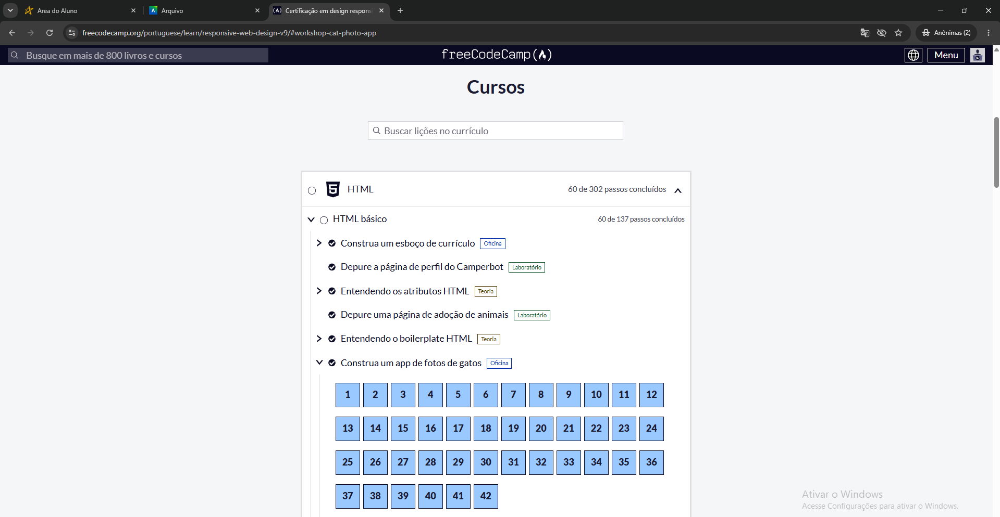

# Resolução de Desafios Práticos
* **Estudante:** Jonathan dos Santos Silva
* **Plataforma Utilizada:** freeCodeCamp 
* **Tecnologia Praticada:**  HTML e CSS
* **Disciplina:** Ciencia da computacao / 1 semestre
---
## Tabela de Exercícios e Comprovações

Criação de uma estrutura básica utilizando HTML.| 
Aprovado |
## Imagem Comprobatória

## Resumo dos Conceitos Praticados
Descreva em 1 ou 2 parágrafos o que você aprendeu:

1 - Durante as atividades realizadas na plataforma freeCodeCamp, aprendi conceitos básicos de HTML, como a criação da estrutura de uma página, utilização de tags, atributos, imagens e links.

2 - As principais dificuldades foram entender a função de algumas tags e atributos. As estruturas mais utilizadas foram as tags HTML, como <html>, <head>, <body>, títulos, parágrafos, imagens e links..